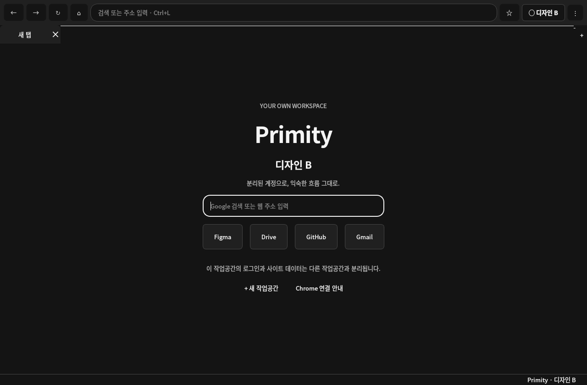

# Primity 0.3.0 · 프리마이티

**분리된 계정으로, 익숙한 흐름 그대로.**

Primity는 Python·PySide6·QtWebEngine으로 만든 Chromium 작업공간 브라우저입니다. 일반 Chrome에서 쓰던 계정을 유지하면서, Primity에서는 다른 계정으로 작업할 수 있도록 사이트 데이터를 작업공간별로 분리합니다. 창마다 작업공간 이름이 표시되고, 같은 작업공간의 탭과 로그인 팝업은 같은 프로필을 사용합니다.



[라이트 화면](docs/images/primity-workspace-light.png) · [시크릿 화면](docs/images/primity-workspace-private.png) · [검증 기록](docs/verification-20261105.md) · [기여 가이드](CONTRIBUTING.md) · [소스 안내](src/README.md)

## 0.3.0에서 사용할 수 있는 기능

| 기능 | 동작 |
| --- | --- |
| 계정 작업공간 | 쿠키, Local Storage, IndexedDB, 서비스 워커, HTTP 캐시를 작업공간별 Qt 프로필에 저장합니다. 이름을 바꿔도 ID와 데이터 경로는 유지됩니다. |
| 여러 창과 탭 | 같은 작업공간의 일반 창은 프로필을 공유합니다. 다른 작업공간은 별도 창으로 열며, 로그인 팝업은 요청한 작업공간의 탭으로 열립니다. |
| 시크릿 창 | 새 창마다 독립된 메모리 프로필을 만듭니다. 창을 닫으면 해당 사이트 데이터를 유지하지 않으며 다운로드한 파일은 남습니다. |
| 일상 탐색 | 주소·Google 검색, 뒤로·앞으로, 새로고침·중지, 탭 이동·닫기·복원, 페이지 찾기, 확대·축소, 전체 화면을 제공합니다. |
| 북마크 | 작업공간별 저장·해제, 메뉴에서 열기, 사용자가 선택한 JSON 가져오기·내보내기를 지원합니다. |
| 다운로드 | 요청한 창에서 저장 위치를 고르고, 진행 상태를 확인하거나 취소할 수 있습니다. |
| 표시 설정 | 작업공간별 한국어·영어와 다크·라이트 테마를 저장합니다. 한글 입력은 운영체제의 입력기를 사용합니다. |
| 사이트 권한 | 출처와 요청 내용을 표시하고 사용자가 허용 여부를 고릅니다. 권한 선택은 앱을 종료하면 초기화됩니다. |

사이트가 발급한 영속 쿠키는 재시작 후에도 저장됩니다. 로그인 만료·로그아웃·세션 쿠키의 유지 여부는 사이트 정책을 따르며, 모든 로그인이 영구적으로 유지되는 것은 아닙니다. 시크릿 창에서는 북마크 변경·가져오기·내보내기와 Chrome 연결을 제공하지 않습니다.

## 설치와 실행

Python **3.10 이상, 3.16 미만**과 해당 운영체제를 지원하는 PySide6 패키지가 필요합니다. 현재 런타임 의존성은 [requirements.txt](requirements.txt)의 **PySide6 6.12.0**으로 고정되어 있습니다. 실제 검증 환경은 **Linux, Python 3.12.14, PySide6/Qt 6.12**입니다. Python과 운영체제 조합의 패키지 지원 범위는 [공식 PySide6 배포 정보](https://pypi.org/project/PySide6/6.12.0/)를 확인하세요.

소스를 내려받아 저장소 루트에서 실행합니다. Linux에서는 일반 데스크톱 사용자로 실행하고 QtWebEngine에 필요한 디스플레이·시스템 라이브러리를 준비합니다.

### Linux / macOS

```bash
python3 -m venv .venv
.venv/bin/python -m pip install -r requirements.txt
bash run.sh
```

### Windows

명령 프롬프트에서 실행합니다.

```bat
py -3 -m venv .venv
.venv\Scripts\python.exe -m pip install -r requirements.txt
run.bat
```

[run.sh](run.sh)와 [run.bat](run.bat)는 저장소의 `.venv`를 사용합니다. 실행 스크립트가 전달받은 인자는 그대로 `main.py`에 전달됩니다. Windows/macOS 실행 안내는 제공하지만, 이 릴리스 작업에서 두 플랫폼의 실행·패키징은 실측하지 않았습니다.

### 명령행 옵션

| 옵션 | 용도 |
| --- | --- |
| `--version` | `Primity 0.3.0`을 출력하고 종료합니다. |
| `--data-dir PATH` | 기본 앱 데이터 위치 대신 지정한 전용 데이터 루트를 사용합니다. |
| `--workspace ID` | 해당 데이터 루트에 이미 존재하는 작업공간 ID를 엽니다. 표시 이름이 아니라 `workspaces.json`의 ID를 사용합니다. |
| 주소 또는 검색어 | 선택한 작업공간에 탭으로 엽니다. 공백이 있는 검색어는 따옴표로 감쌉니다. |

```bash
bash run.sh --version
bash run.sh --data-dir "$HOME/Primity-test-data" --workspace default https://www.figma.com/
bash run.sh "Qt WebEngine documentation"
```

같은 데이터 루트에는 Primity 프로세스 하나만 접근하도록 잠급니다. 이미 실행 중이면 앱 안의 새 창·작업공간 메뉴를 사용하세요. 별도 테스트 실행에는 서로 다른 `--data-dir`을 지정할 수 있습니다.

## Figma A/B 계정으로 작업하기

1. 평소 쓰는 Google Chrome에서 Figma **A 계정**을 유지합니다.
2. Primity를 실행하고 작업공간 버튼에서 **+ 새 작업공간**을 선택합니다. 예를 들어 `디자인 B`라는 이름을 지정합니다.
3. 새 작업공간에서 Figma를 열고 **B 계정**으로 로그인합니다. Chrome의 쿠키나 로그인 정보는 가져오지 않습니다.
4. Primity에서 계정을 하나 더 분리하려면 작업공간을 추가합니다. 같은 작업공간에 탭이나 일반 창을 추가하면 기존 로그인 세션을 공유합니다.
5. 사이트가 임베디드 로그인을 거절하면 아래의 **Chrome으로 연결 · 독립 프로필** 기능을 이용해 별도 Chrome 창에서 해당 작업을 진행합니다.

이 절차는 데이터 분리 방식을 설명합니다. 실제 Google/Figma 자격증명을 사용한 인증 성공 여부는 이번 검증 범위에 포함하지 않았습니다.

## Google 로그인, Chrome Sync, Chrome 연결

**웹사이트의 Google 로그인과 Chrome 브라우저 동기화는 별개입니다.** QtWebEngine 기반 Primity에는 Google Chrome Sync의 공식 지원이 없습니다. Chromium 프로젝트는 Chrome Sync 등 Google 전용 API의 제3자 Chromium 브라우저 접근을 제한한다고 안내합니다. [공식 Chromium 안내](https://blog.chromium.org/2021/01/limiting-private-api-availability-in.html)

또한 Google OAuth 정책은 개발자가 제어하는 임베디드 사용자 에이전트에서의 인증을 제한합니다. 따라서 일부 Google 로그인·SSO 흐름은 Primity에서 거절될 수 있습니다. [Google OAuth 2.0 정책: Use secure browsers](https://developers.google.com/identity/protocols/oauth2/policies#use-secure-browsers)

설치된 Google Chrome을 사용하려면 일반 창의 `⋮` 메뉴에서 **Chrome으로 연결 · 독립 프로필**을 선택하고 안내를 확인합니다.

- 작업공간 전용 `--user-data-dir`로 실제 Google Chrome을 실행합니다. 평소 Chrome의 프로필 디렉터리는 사용하지 않습니다.
- 현재 웹 주소를 전달하지만 **Qt와 Chrome의 쿠키·로그인 세션은 서로 공유하지 않습니다.** 열린 Chrome에서 별도로 로그인해야 합니다.
- Chrome 자체 동기화는 그 Chrome 창의 프로필 메뉴에서 설정합니다. 사용 가능 여부는 Chrome과 계정·조직 정책을 따릅니다.
- Chrome이 설치되어 있지 않거나 탐색할 수 없으면 안내를 표시합니다. 기본 브라우저로 자동 전환하지 않습니다.

로그인 호환성을 위해 브라우저 신원을 위장하거나 쿠키·토큰을 복사하지 않습니다. Chrome의 데이터 디렉터리 동작은 [Chromium 공식 문서](https://chromium.googlesource.com/chromium/src/+/main/docs/user_data_dir.md)를 참고하세요.

## 자주 쓰는 단축키

아래 표는 코드에 등록된 키 조합입니다. macOS에서의 키 배치는 별도로 실측하지 않았습니다.

| 동작 | 단축키 |
| --- | --- |
| 주소창 선택 | `Ctrl+L` |
| 새 탭 / 탭 닫기 | `Ctrl+T` / `Ctrl+W` |
| 닫은 탭 다시 열기 | `Ctrl+Shift+T` |
| 같은 작업공간 새 창 | `Ctrl+N` |
| 새 시크릿 창 | `Ctrl+Shift+N` |
| 다음 / 이전 탭 | `Ctrl+Tab` / `Ctrl+Shift+Tab` |
| 1~8번 탭 / 마지막 탭 | `Ctrl+1`~`Ctrl+8` / `Ctrl+9` |
| 뒤로 / 앞으로 | `Alt+Left` / `Alt+Right` |
| 새로고침·중지 / 새로고침 | `Ctrl+R` / `F5` |
| 북마크 저장·해제 | `Ctrl+D` |
| 페이지에서 찾기 | `Ctrl+F` |
| 확대 / 축소 / 기본 크기 | `Ctrl++` 또는 `Ctrl+=` / `Ctrl+-` / `Ctrl+0` |
| 전체 화면 | `F11` |
| 전체 화면·찾기 종료 또는 탐색 중지 | `Esc` |

닫은 탭 복원은 현재 창에서 닫은 웹 주소 최대 20개를 기억합니다. 앱 재시작 후 전체 탭 세션을 복원하는 기능은 없습니다. 마지막 탭을 닫으면 해당 창도 닫힙니다.

시크릿 창에서 `Ctrl+N`을 누르면 새로운 독립 시크릿 창을 엽니다. 일반 창으로 전환하려면 작업공간 메뉴에서 이름을 선택합니다.

## 저장 위치와 북마크 이동

기본 데이터 루트는 `QStandardPaths.AppLocalDataLocation`입니다. 조직 이름과 앱 이름은 모두 `Primity`이며, 실제 경로는 운영체제 설정에 따라 달라집니다. 일반적으로 Linux의 `~/.local/share`, Windows의 `%LOCALAPPDATA%`, macOS의 `~/Library/Application Support` 아래 앱 전용 경로를 사용합니다. 경로 규칙은 [Qt QStandardPaths 공식 문서](https://doc.qt.io/qt-6/qstandardpaths.html)를 참고하세요. 고정 위치가 필요하면 `--data-dir`을 지정합니다.

| 데이터 루트 기준 경로 | 내용 |
| --- | --- |
| `workspaces.json` | 작업공간 ID·표시 이름·마지막 작업공간 |
| `instance.lock` | 같은 데이터 루트의 중복 실행 방지 |
| `workspaces/<id>/qt/` | 해당 작업공간의 Qt 사이트 데이터 |
| `workspaces/<id>/cache/` | 해당 작업공간의 Qt HTTP 캐시 |
| `workspaces/<id>/state/bookmarks.json` | 북마크 제목과 웹 주소 |
| `workspaces/<id>/state/preferences.json` | 테마와 UI 언어 |
| `workspaces/<id>/chrome/` | 선택적 Chrome 연결 전용 사용자 데이터 |

북마크는 `⋮ → 이 작업공간의 북마크 → JSON 가져오기… / JSON 내보내기…`에서 이동합니다. 가져오기는 기존 북마크에 URL 기준으로 병합하며, 쿠키·비밀번호·로그인·설정을 이식하지 않습니다. 이전 버전의 컬렉션 형식도 북마크 부분만 명시적으로 선택해 가져올 수 있습니다. 파일 크기는 2 MiB, 작업공간당 북마크는 5,000개까지 검사합니다.

현재 버전의 내보내기 형식은 다음과 같습니다.

```json
{
  "version": 1,
  "bookmarks": [
    {"title": "Figma", "url": "https://www.figma.com/"}
  ]
}
```

작업공간 삭제 UI는 제공하지 않습니다. 손상되거나 지원하지 않는 메타데이터는 오류로 알리며 원본을 보존합니다. 데이터 폴더를 백업할 때는 Primity와 해당 전용 프로필을 사용하는 Chrome을 먼저 종료하세요. 사용자 프로필·쿠키·비밀번호는 저장소나 빌드 결과에 포함하지 않습니다.

## 개발 검증과 수동 빌드

[requirements-dev.txt](requirements-dev.txt)는 런타임 의존성과 pytest·PyInstaller의 고정 버전을 포함합니다.

```bash
.venv/bin/python -m pip install -r requirements-dev.txt
.venv/bin/python -m pytest -q
.venv/bin/python -m compileall -q main.py src tests scripts
.venv/bin/python scripts/build.py
```

Windows에서는 같은 순서로 `.venv\Scripts\python.exe`를 사용합니다. GUI 테스트에는 QtWebEngine과 동작하는 디스플레이가 필요합니다. 화면 없는 Linux 테스트에서는 환경이 지원하는 경우 Xvfb 또는 `QT_QPA_PLATFORM=offscreen`을 사용할 수 있습니다. 디스플레이 준비가 안 됐다면 전체 GUI 검증을 완료했다고 기록하지 않습니다.

[scripts/build.py](scripts/build.py)는 실행 중인 운영체제에서 PyInstaller `onedir` 패키지를 만듭니다. 교차 빌드는 제공하지 않으며, Windows·macOS 배포물은 해당 운영체제에서 직접 빌드하고 검증해야 합니다. Linux 실행 파일은 `dist/Primity/Primity`이며, 배포할 때는 같은 폴더의 의존 파일도 함께 포함합니다. 빌드에는 [LICENSE](LICENSE)와 [NOTICE](NOTICE)를 포함합니다. GitHub Workflows를 통한 자동 빌드는 사용하지 않습니다.

### 확인한 범위

2026-11-05 Linux 검증 기록:

- Python 3.12.14, PySide6/Qt 6.12 환경의 최종 전체 테스트 **77 passed, 3.57s**. `main.py`, `src`, `tests`, `scripts`의 컴파일 검사 통과.
- 로컬 HTTP 사이트로 쿠키·Local Storage·IndexedDB·서비스 워커의 작업공간 분리, 시크릿 프로필, 팝업의 프로필·opener, 다운로드, 별도 프로세스 재시작 후 영속 쿠키·저장소 유지 확인.
- 저장소 경로·손상 JSON·원자적 저장·주소 해석·Chrome 명령 인자·단일 실행 잠금 검사 포함.
- Linux PyInstaller `onedir` 최종 빌드 성공: 약 **631 MiB**, 빌드 **17.7s**. 패키지의 `--version` 출력과, 별도 라이브러리 경로 추가 없이 offscreen 환경에서 임시 프로필로 로컬 HTTP 페이지 렌더링·JavaScript fetch 응답 확인.
- 앱이 직접 사용하지 않는 QML labs assetdownloader 선택 플러그인의 라이브러리 경고 1개가 남았습니다. 상세 환경·빌드 결과·검증 범위는 [검증 기록](docs/verification-20261105.md)에 정리했습니다.

GUI·패키지 검증은 격리된 루트 테스트 환경에서 수행했으며, 그 환경에서만 QtWebEngine sandbox를 비활성화했습니다. 제품 코드와 빌드 스크립트에는 해당 옵션이 없습니다. 이 결과가 일반 데스크톱의 sandbox 동작까지 실측했다는 뜻은 아닙니다.

실제 Google/Figma 계정 로그인, 설치된 Chrome의 실제 실행, Windows/macOS 실행·패키징은 미검증입니다. [Dockerfile](Dockerfile)도 정비했지만 Docker 빌드·실행은 실측하지 않았습니다. 브라우저 저장소 분리는 같은 OS 계정의 다른 프로그램이나 사이트 서버가 계정을 연관 짓는 동작까지 격리하는 보안 경계는 아닙니다.

## 이전 아카이브·비밀번호·IME 코드

아카이브 엔진·대시보드, 이전 비밀번호 페이지와 사용자 정의 한글 IME 모듈은 소스에 보존되어 있습니다. **0.3.0의 일반 실행 경로에는 연결하지 않습니다.** 기존 평문 비밀번호를 자동으로 읽거나 가져오지 않으며, 사용자 정의 입력기나 아카이브 스크립트를 일반 웹사이트에 주입하지 않습니다. 기존 데이터도 자동 삭제·변환하지 않습니다.

현재 실행 경로는 Chromium의 웹 보안·sandbox·site isolation을 끄는 옵션을 추가하지 않고, 인증서 오류를 거절합니다. 보존된 실험 코드를 현재 브라우저 기능으로 간주하지 마세요. 구성은 [소스 안내](src/README.md), 작업 범위는 [설계 문서](docs/superpowers/specs/2026-11-05-workspaces-design.md)에 정리했습니다.

## English summary

Primity 0.3.0 is a Python/PySide6 browser with one persistent QtWebEngine profile per workspace. Cookies, web storage, service workers, cache, bookmarks, and appearance settings are kept separate. Tabs and ordinary windows in the same workspace share its profile; each private window gets a fresh in-memory profile. Downloads remain on disk.

Create `.venv`, install `requirements.txt`, then run `bash run.sh` or `run.bat`. Development tools are pinned in `requirements-dev.txt`; run tests and `scripts/build.py` with the virtual environment's Python. The application accepts `--data-dir`, `--workspace`, `--version`, and URL/search arguments. One process owns each data root.

Google website sign-in and Chrome Sync are different features. Primity does not provide official Chrome Sync integration, and embedded Google OAuth may be rejected. The explicit **Open in Chrome · isolated profile** action launches installed Google Chrome with a workspace-specific user-data directory. Qt sessions, this Chrome profile, and your normal Chrome profile remain separate; sign in again in Chrome.

Linux tests passed: **77 tests in 3.57 seconds**, using Python 3.12.14 and PySide6/Qt 6.12. The Linux PyInstaller `onedir` build is about 631 MiB; its version output, local page rendering, and JavaScript fetch callback were verified. The isolated root test environment disabled the QtWebEngine sandbox for testing only; application and build scripts do not add that setting. Normal desktop sandbox behavior, real Google/Figma authentication, actual installed-Chrome launch, Windows/macOS packages, and Docker execution remain unverified. Legacy archive, password, and custom IME modules remain in the source but are disconnected from the 0.3.0 runtime.

## 라이선스와 기여

[MIT License](LICENSE). 변경 전 [AGENTS.md](AGENTS.md), [코딩헌법](CODING_CONSTITUTION.md), [CONTRIBUTING.md](CONTRIBUTING.md)를 읽어 주세요. 개발은 고유 작업 브랜치와 작은 API 커밋으로 진행하며, 신규 PR과 GitHub Workflows를 만들지 않습니다.
